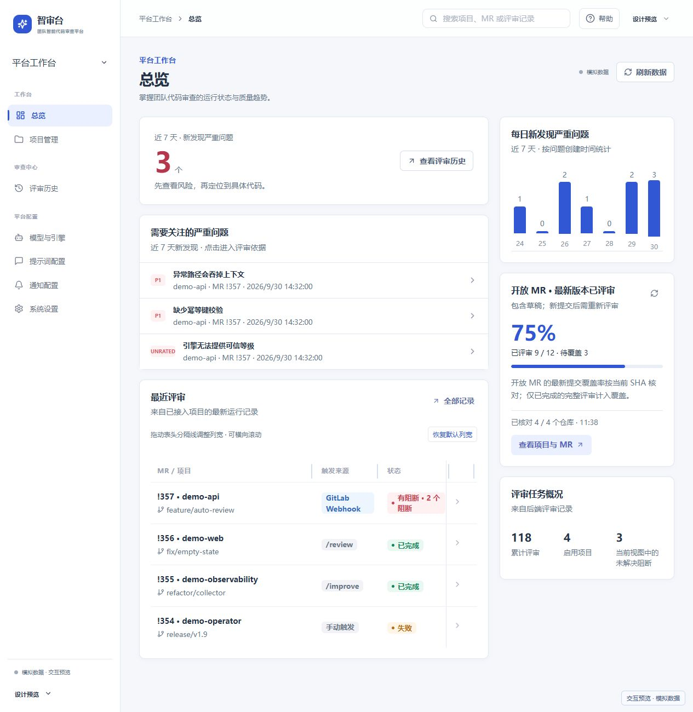

<div align="center">

# ✨ 智审台 · CW-CR

**让每一次 GitLab Merge Request，都有可追溯的 AI 评审。**

自托管 · 中文行级评审 · 多模型与引擎 · 项目权限 · 合并门禁

[](https://github.com/bennie-asi/cw-cr/actions/workflows/docker.yml)
[](LICENSE)
[](https://github.com/bennie-asi/cw-cr/pkgs/container/cw-cr)
[](https://react.dev/)
[](https://www.djangoproject.com/)

[快速部署](#-快速部署) · [功能](#-把评审变成团队工作流) · [部署指南](docs/deployment.md) · [接入指南](docs/integrations.md) · [参与贡献](CONTRIBUTING.md)

</div>

智审台把 GitLab MR、模型推理、行级评论、中文总评和企业微信通知串成一条工作流。团队在一个界面里管理项目、检查评审证据、追踪问题和配置合并策略，代码和连接凭据保留在自己的部署环境中。调用远端模型时，评审所需的代码与上下文会发送至你配置的模型服务。



*上图为产品交互演示，使用合成项目和评审数据。正式部署从真实数据库和已配置服务加载数据。*

## 🚀 快速部署

需要 Docker Engine / Docker Desktop 和 Docker Compose。镜像内已包含前端、API 与评审 worker，支持 Linux amd64 / arm64。

### Docker Compose

```bash
git clone https://github.com/bennie-asi/cw-cr.git
cd cw-cr
docker compose up -d
docker compose exec app python manage.py createsuperuser
```

打开 **http://localhost:8080**，使用刚创建的管理员登录。首次启动自动迁移数据库、生成独立密钥；数据保存在命名卷中。

默认配置可直接启动。需要改端口、域名或连接时，将 [`.env.docker.example`](.env.docker.example) 复制为 `.env` 再编辑。GitLab、模型与企业微信也可在登录后的页面配置。

### Docker

```bash
docker run -d --name cw-cr --restart unless-stopped -p 127.0.0.1:8080:8080 --add-host host.docker.internal:host-gateway -v cw-cr-data:/data ghcr.io/bennie-asi/cw-cr:latest
docker exec -it cw-cr python manage.py createsuperuser
```

### 从源码构建

```bash
docker compose -f compose.yaml -f compose.build.yaml up -d --build
docker compose exec app python manage.py createsuperuser
```

默认入口绑定主机回环地址，适合本机体验。通过域名部署、HTTPS、接入 PostgreSQL、备份与升级，请按 [部署指南](docs/deployment.md) 配置。不要把应用容器横向扩容到多台主机。

## 🧩 把评审变成团队工作流

| 能力 | 你可以做什么 |
| --- | --- |
| GitLab MR 评审 | 接收 Merge Request Webhook，在页面触发 review / improve，持续队列处理与失败重试 |
| 有证据的行级反馈 | 核对实际 diff、提交 SHA、新旧行号和原代码，再发布 Discussions 与原生 suggestion |
| 中文总评 | 查看、编辑并同步 MR 总评，保留评审与发布阶段记录 |
| 模型与引擎 | 配置 OpenAI / Anthropic 兼容服务、CCSwitch 网关，平台默认与项目覆盖独立管理 |
| 合并门禁 | 按 P0 / P1 / P2 阈值和未评级问题阻断；自动合并需要显式启用并通过 dry-run |
| 团队协作 | 会话登录、CSRF、平台管理员、项目管理员与成员权限，项目成员独立授权 |
| 企业微信 | 推送评审与合并结果，查看发送记录，失败或不确定状态显式处理 |
| 项目工作台 | 评审历史、近期严重问题、开放 MR 当前 SHA 的完整评审覆盖情况 |
| 凭据保护 | 独立 Fernet 密钥加密数据库凭据，接口仅返回掩码和配置状态 |

默认镜像提供内置评审引擎。PR-Agent、OpenCodeReview、Pi Agent 是可选适配器，需要额外安装对应运行时，并完成版本探测与当前模型的合成验证；安装说明见 [接入指南](docs/integrations.md)。

## 🔌 接入你的团队

1. **系统设置**：配置 GitLab 地址、API Token 和 Webhook Secret，测试连接。
2. **模型与引擎**：配置兼容 API 的 Base URL、Key 和模型，测试后保存。
3. **项目管理**：添加真实仓库，完成连接检查，授权项目成员。
4. **GitLab**：添加 Merge request events Webhook，目标为 `https://你的域名/api/webhooks/gitlab/`，填写匹配的 Secret。
5. **通知配置**：按需添加企业微信机器人，发送测试消息。

Webhook 地址必须能从 GitLab 服务器访问。容器里的 `127.0.0.1` 指向容器本身；连接主机上的模型网关可使用 `host.docker.internal`，并确保网关允许来自容器的访问。

页面保存的配置优先于环境变量。保存时将已有秘密字段留空，可保留原值。详细的继承规则、Token 用途、引擎安装与常见问题见 [接入指南](docs/integrations.md)。

## 📦 一键打包镜像

在仓库 **Actions → Docker → Run workflow** 中选择分支，点击运行。可选填写额外镜像标签，例如 `demo-20261010`。

工作流先运行前后端测试、生产构建、迁移检查和容器冒烟，再发布到 `ghcr.io/<仓库所有者>/cw-cr`。无需额外配置 Docker Hub 密码，使用仓库的 `GITHUB_TOKEN`。

| 触发方式 | 镜像标签 |
| --- | --- |
| 推送 `main` | `latest`、`sha-<commit>` |
| 推送 `v1.2.3` 等版本标签 | `1.2.3`、`1.2`、`sha-<commit>` |
| 手动运行 | `sha-<commit>`、可选自定义标签；`main` 同时更新 `latest` |

PR 运行 CI，不推送镜像。镜像包含 amd64 / arm64 清单和源码关联标签。Fork 后第一次发布，需在 GitHub Package 设置中将新包设为 Public，才能匿名拉取。

## 🛠️ 本地开发

需要 **Python 3.11+、Node.js 22+**。初始化虚拟环境、安装依赖、创建密钥与管理员后，分别启动 Django、worker 和 Vite。完整的 Linux/macOS 与 Windows 命令见 [开发指南](docs/development.md)。

```bash
npm ci
npm run test:ci
npm run build
python backend/manage.py test review config --noinput
python backend/manage.py makemigrations --check --dry-run
python backend/manage.py check
python backend/scripts/delivery_smoke.py
```

测试使用隔离数据库和模拟集成；真实 GitLab、模型调用与企业微信投递需要部署后验证。

## 🤝 参与贡献

欢迎提交可复现的 Issue、文档改进和 PR。请先读 [贡献指南](CONTRIBUTING.md)；安全问题通过 [私密报告入口](SECURITY.md) 提交。

如果这个项目帮团队省下了评审时间，欢迎点个 Star，或分享你的使用反馈。

## 📄 许可证

[MIT](LICENSE) © 2026 Bennie。可选第三方引擎分别遵循其自身许可证。
